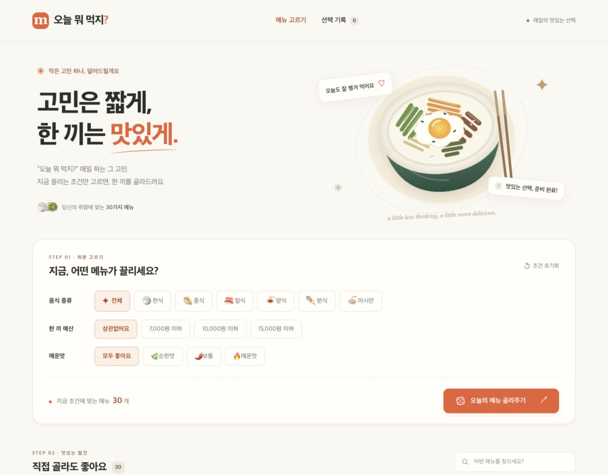
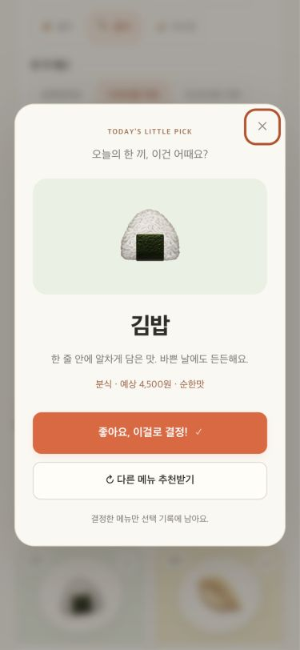

# 오늘 뭐 먹지? 🍽️

**고민은 짧게, 한 끼는 맛있게.**

음식 종류·예산·매운맛으로 후보를 좁히고 오늘 먹을 메뉴를 고르는 웹앱입니다.

> 인공지능프로그래밍 중간고사 · 기존 실습 결과물 없이 시작한 신규 프로젝트

**[웹앱 실행하기](https://baw-appie.github.io/oneul-menu/)** · **[GitHub Public 저장소](https://github.com/Baw-Appie/oneul-menu)** · **[커밋 내역](https://github.com/Baw-Appie/oneul-menu/commits/main/)**



## 1. 제작한 것 소개

### 제작 목적

점심과 저녁마다 반복되는 “뭘 먹지?”라는 고민을 줄이고 싶다는 상황에서 출발했습니다. 원하는 조건으로 메뉴를 추린 뒤 하나를 추천받거나, 목록에서 직접 선택할 수 있습니다.

주 사용자는 한 끼 예산과 음식 취향을 고려해 빠르게 메뉴를 결정하려는 대학생입니다. 기본 추천은 조건 필터와 무작위 선택으로 동작합니다. 추가 개발에서는 GPT-6 Luna(`gpt-6-luna`)가 문장을 해석하는 자연어 검색을 연결했습니다. **AI 검색은 API 키가 설정된 로컬 서버에서 동작하며, GitHub Pages 공개 데모에는 아직 AI 서버가 연결되어 있지 않습니다.**

### 구현 기능

- **메뉴 30개**: 한식·중식·일식·양식·분식·아시안 메뉴와 예시 가격, 매운맛 표시
- **복합 조건**: 종류, 최대 예산, 매운맛, 이름·설명·태그 검색을 동시에 적용
- **메뉴 제외·복원**: 원하지 않는 메뉴를 후보에서 빼고 다시 포함
- **무작위 추천**: 화면에 나온 후보에서 선택하고, 여러 후보가 있으면 직전 추천 회피
- **결과 확정**: 추천 창에서 확정해야 기록에 추가. 취소한 추천은 기록하지 않음
- **선택 기록**: 같은 날짜의 같은 메뉴 중복 방지, 최신 30개 보관, 개별 삭제
- **브라우저 저장**: 필터·제외 목록·기록을 새로고침 후 복원
- **사용성**: 모바일 화면, 키보드 조작, 빈 결과 안내, 저장 실패 안내
- **자연어 검색**: “만원 이하로 맵지 않은 국물 요리”처럼 입력하면 현재 조건 안에서 메뉴를 검색. 결과 설명·취소·검색 해제 지원

가격은 직접 작성한 **시연용 예시 금액**입니다. 실제 가격·재료·매운맛은 식당마다 다릅니다. 식당 검색이나 배달 주문 서비스는 아닙니다.

### 실행 방법

별도 패키지 설치나 빌드 없이 실행합니다. 로컬 실행에는 Node.js 20 이상이 필요합니다.

```bash
node server.mjs
```

터미널에 출력되는 `http://127.0.0.1:4173`을 브라우저에서 엽니다. 종료는 `Ctrl+C`입니다. 포트를 바꾸려면 macOS/Linux에서 `PORT=4174 node server.mjs`로 실행합니다.

**AI 검색 실행:** `.env.example`을 `.env`로 복사하고 `OPENAI_API_KEY`를 설정한 뒤 실행합니다. `.env`는 Git에서 제외됩니다. Node.js 20.6 이상이 필요합니다.

```bash
node --env-file=.env server.mjs
```

[자연어 검색 설정·동작·한계](docs/AI_SEARCH.md)를 참고하세요. 검색 문장과 메뉴 후보만 OpenAI로 전송하고 선택 기록은 전송하지 않습니다. 실제 키를 소스·README·채팅에 넣지 마세요.

JavaScript ES modules를 사용하므로 `index.html`을 더블클릭하는 `file://` 실행 대신 위 HTTP 서버 또는 정적 호스팅을 사용합니다.

저장 데이터는 **현재 브라우저와 접속 주소**에 속합니다. 로컬 주소와 배포 주소의 기록은 서로 다르며, 브라우저 데이터를 지우면 기록도 사라집니다.

### 기술과 파일 구조

HTML, CSS, JavaScript만 사용합니다. 기본 메뉴 기능은 외부 API·이미지 서버·폰트·런타임 라이브러리에 의존하지 않습니다. 자연어 검색만 로컬 서버의 내장 `fetch`로 OpenAI Responses API를 호출합니다. 소개 그림은 직접 작성한 SVG이며 메뉴 그림은 시스템 이모지입니다.

```text
index.html                         화면과 결과 대화상자
styles.css                         PC·모바일 스타일
src/data.mjs                       메뉴 30개
src/core.mjs                       필터·추천·기록·저장값 검증
src/app.mjs                        화면 갱신과 사용자 이벤트
src/ai-search.mjs                  자연어 검색 상태·취소·결과 연결
server.mjs                         로컬 웹 서버
server/ai-search.mjs               GPT-6 Luna 호출과 응답 검증
server/search-route.mjs            API 경로·입력 크기·요청 제한
assets/                            SVG 그림과 아이콘
docs/PRD.md                        제품 요구사항
docs/TODO.md                       단계별 작업과 실제 변경 내역
docs/VERIFICATION.md               수행한 검증과 한계
docs/AI_SEARCH.md                  자연어 검색 실행과 데이터 처리
skills/meal-picker-review/SKILL.md   프로젝트 전용 스킬
```

## 2. PRD와 Todo 리스트

전체 문서: [PRD](docs/PRD.md) · [Todo와 변경 내역](docs/TODO.md)

### PRD 요약

| 구분 | 내용 |
| --- | --- |
| 문제 | 메뉴 선택에 반복해서 시간을 쓰고, 예산과 취향에 맞춰 후보를 좁히기 어려움 |
| 대상 | PC·모바일 브라우저로 오늘 먹을 메뉴를 고르는 대학생 |
| 핵심 가치 | 조건 선택 → 후보 확인 → 추천 또는 직접 선택 → 기록 |
| 필수 기능 | 메뉴 탐색, 복합 필터·제외, 추천, 선택 기록, 브라우저 저장 |
| 완성 기준 | 조건에 맞는 결과, 후보 0/1개 처리, 중복 기록 방지, 새로고침 복원, 모바일 사용 |
| 추가 기능 | GPT-6 Luna 자연어 검색, 로컬 서버에서 API 키 사용 |
| 제외 범위 | 로그인, 기기 간 동기화, 지도, 실시간 가격, 주문·결제, 공개 AI 서버 배포 |

### 초기 작업 순서

1. **기획**: PRD, Todo, 스킬 작성 후 첫 커밋
2. **화면**: 30개 메뉴 데이터와 반응형 기본 화면 구현 후 커밋
3. **기능**: 필터, 추천, 확정, 기록·저장 기능 구현 후 커밋
4. **검증**: 경계 상황과 브라우저 흐름 확인, 발견한 문제 수정 후 커밋
5. **제출 준비**: README·스킬·회고 초안 정리, Public 저장소와 실행 주소 확인

작업마다 `단계-순번` 번호와 PRD 근거를 붙였습니다. 처음부터 완료된 프로젝트를 한 번에 커밋하지 않았으며, 최초 계획은 `2318c27`에 보존했습니다.

| 커밋 | 작업 내용 |
| --- | --- |
| [2318c27](https://github.com/Baw-Appie/oneul-menu/commit/2318c27) | PRD, 초기 Todo, 검증 스킬 작성 |
| [5ecb9bf](https://github.com/Baw-Appie/oneul-menu/commit/5ecb9bf) | 반응형 기본 화면과 메뉴 30개 |
| [2cda38c](https://github.com/Baw-Appie/oneul-menu/commit/2cda38c) | 복합 필터, 추천, 선택 기록과 브라우저 저장 |
| [942d673](https://github.com/Baw-Appie/oneul-menu/commit/942d673) | 실제 검증 후 키보드 탐색·빈 결과 복원 개선 |
| [d39d20e](https://github.com/Baw-Appie/oneul-menu/commit/d39d20e) | 과제 README, 스킬 사용 내역, 발표 시연 가이드 |

## 3. Todo 리스트의 변경 내역

최초 계획과 비교한 **실제 변경 사항**입니다. 처음부터 계획했던 기능을 나중에 추가한 것처럼 꾸미지 않았습니다.

| 관련 Todo | 처음 계획 | 실제 변경 | 변경 이유와 확인 결과 |
| --- | --- | --- | --- |
| 3-5, 4-3 | 삭제 후 다음 요소에 포커스 이동 | 남은 삭제 버튼의 기본 Tab 순서 유지 | 실제 브라우저에서 삭제 후 `tabindex=-1`이 남는 문제 발견. 수정 후 속성이 없는 기본 버튼으로 유지됨을 확인 |
| 3-1, 4-3 | 별도 제외 목록에서 메뉴 복원 | 빈 결과 안내에 **제외한 메뉴 다시 포함** 버튼 추가 | 검색 결과 하나를 제외했을 때 복원 경로를 더 쉽게 찾도록 개선. 클릭 후 후보 1개 복구 확인 |
| 3-5, 4-3 | 빈 결과에서 조건 초기화 | 초기화 후 추천 또는 제외 관리로 포커스 이동 | 초기화 버튼이 사라져도 키보드 사용자가 다음 동작을 이어갈 수 있도록 개선 |
| 2-4, 4-4 | 미리보기 서버의 src·assets 경로 허용 | 제공할 파일명·확장자를 앱 자원으로 제한 | 코드 검토 후 로컬 서버가 제공하는 파일 범위를 명시적으로 좁힘 |
| 6-1–6-6 | AI API 없이 키워드 검색만 제공 | GPT-6 Luna 자연어 검색 추가, 서버에서 키 관리 | 사용자가 모델과 로컬 실행 범위를 확인. 실제 문장 검색에서 쌀국수·돼지국밥·우동, 한식 조건에서는 돼지국밥 확인 |

기획에서 정한 로그인·지도·주문 등의 제외 범위는 유지했습니다.

### 검증 결과

- **로직 12개 그룹 통과**: 112개 필터 조합, 예산 경계, 후보 0/1/다수, 재추천, 중복 방지, 로컬 날짜, 최신 30개 제한, 저장값 검증 등
- **저장 실패 모의 시나리오 2개 통과**: 손상된 JSON과 저장소 차단에서도 화면·필터 동작 유지
- **실제 브라우저 확인**: 추천·취소·재추천·확정·중복 방지·새로고침·검색·제외 복원·기록 삭제
- **반응형 확인**: 375px와 1280px에서 가로 넘침 없음. 모바일 추천 창 및 Enter/Escape 조작 확인
- **오류 로그**: 확인 시 브라우저 error/warn 로그 없음
- **자연어 검색 추가 검증**: 16개 모의 검증 그룹과 실제 GPT-6 Luna 호출 4회 확인. 후보 밖 ID 거부, 오류·취소·오래된 응답 무시, 10원 이하 검색의 빈 결과, 모바일 입력 검증

[검증 환경·세부 결과·미검증 범위](docs/VERIFICATION.md)에 실제 수행 내용을 구분해서 기록했습니다. 임시 검증 코드는 저장소에 남기지 않았습니다.

<details>
<summary>모바일 추천 화면 보기</summary>



</details>

## 4. 스킬

### 직접 만든 스킬: meal-picker-review

**만든 이유:** 화면이 보기 좋아도 필터와 추천 후보가 다르거나, 기록이 중복되거나, 날짜가 잘못 구분되면 앱의 목적을 달성하기 어렵습니다. 이 프로젝트에서 반복 확인해야 하는 판단 기준을 재사용할 수 있는 절차로 정리했습니다.

**적용 방법:** 루트 `AGENTS.md`에서 메뉴 데이터·필터·추천·기록을 수정할 때 이 스킬을 읽도록 연결했습니다. 첫 기능 구현 전에 실제로 읽고 적용했습니다.

| 스킬 규칙 | 실제 사용 사례 |
| --- | --- |
| 필터는 AND, 예산 경계 포함 | 112개 조합과 10,000원 경계 조건 검증 |
| 화면 후보와 추천 후보 일치 | `filterMenus()`의 결과를 카드와 추천에서 공통으로 사용 |
| 후보 0/1/다수 구분 | 빈 결과 안내, 후보 하나일 때 재추천 비활성화, 다수일 때 직전 추천 제외 |
| 확정한 메뉴만 기록 | Escape 취소 후 기록 0개, 같은 메뉴 두 번 확정 후 기록 1개 확인 |
| 로컬 날짜 기준 | `localDateKey()` 사용, 서울 자정 부근 날짜 검증 |
| 저장값을 신뢰하지 않음 | 메뉴 ID·날짜·필터 값 정규화, 손상된 JSON·저장 차단 처리 |
| 키보드 흐름 확인 | 기록 삭제 후 Tab 탐색 문제를 발견하고 수정 |
| 사실에 근거한 기록 | 실제 변경·검증만 Todo에 기록하고 회고는 사용자 검토용 초안으로 구분 |
| 자연어 검색 확장 규칙 | 모델 결과를 기존 후보의 부분집합으로 검증하고, 입력 변경 시 이전 응답 무효화. 실제 호출과 모의 검증을 구분 |

#### SKILL.md 전문

원본: [skills/meal-picker-review/SKILL.md](skills/meal-picker-review/SKILL.md)

```markdown
---
name: meal-picker-review
description: 오늘 뭐 먹지 웹앱의 메뉴 데이터, 조건 필터, 무작위 추천, 선택 기록을 구현하거나 수정할 때 제품 규칙과 경계 상황을 검증한다.
---

# 메뉴 추천 검증

## 제품 규칙

- 메뉴 ID는 중복되지 않아야 한다. 가격은 원 단위의 양의 정수이며 시연용 예시다. 매운맛은 0(순한맛), 1(보통), 2(매운맛) 중 하나다.
- 검색어와 음식 종류, 최대 예산, 매운맛, 제외 ID는 AND로 결합한다. 예산과 같은 가격의 메뉴도 포함한다.
- 추천 후보는 화면에 표시한 필터 결과와 같아야 한다. 후보 0개는 안내, 1개는 그 메뉴, 여러 개면 바로 직전 추천을 뺀 후보에서 균등 선택한다.
- 추천 대화상자를 열기만 해서는 기록하지 않는다. 사용자가 확정한 메뉴만 기록한다. 같은 로컬 날짜와 메뉴 ID 조합은 한 번만 남긴다.
- 날짜는 사용자의 로컬 달력 날짜로 판단한다. UTC 날짜 문자열을 잘라 하루를 구분하지 않는다.
- 저장 데이터는 신뢰하지 않는다. 알려진 메뉴 ID, 필터 선택값, 날짜와 목록 크기를 검증하고 잘못된 항목을 버린다. 저장을 사용할 수 없어도 메모리에서 앱을 계속 쓸 수 있어야 한다.
- 자연어 검색 결과는 서버에 보낸 후보의 부분집합이어야 한다. 모델이 반환한 ID와 설명도 검증한다. 카드와 랜덤 추천은 같은 AI 결과 집합을 사용한다.
- 검색어·조건이 바뀌거나 검색을 취소하면 진행 중 응답을 무시한다. 실패한 검색은 기존 조건 검색을 망가뜨리지 않는다. 실제 모델 호출과 모의 검증을 구분한다.
- API 키는 서버 환경 변수에서만 사용한다. 검색 문장과 후보만 전송하고 기록은 전송하지 않는다. 실제 재료 정보가 없는 메뉴에 알레르기 안전성을 보장하지 않는다.

## 확인 절차

1. 변경한 PRD 항목과 Todo 번호를 확인한다.
2. 데이터 변경이면 ID·가격·매운맛을 검사한다. 추천 변경이면 조건을 여러 개 겹친 경우와 후보 0/1/다수를 확인한다.
3. 추천 → 다시 추천 → 확정 → 새로고침 → 기록 삭제 흐름을 검증한다. 취소한 추천이 기록되지 않는지도 확인한다.
4. 키보드로 대화상자 열기·닫기·확정이 가능한지, 모바일에서 조건과 결과가 잘리지 않는지 확인한다.
5. 실제 수행한 검증과 미수행 항목을 구분하여 기록한다. 개선으로 계획이 바뀌면 `docs/TODO.md`에 변경 전·후와 근거를 남긴다.

## 예시

한식 / 10,000원 이하 / 순한맛 조건에서는 10,000원 메뉴가 포함되고 11,000원 메뉴는 제외된다. 모든 후보를 제외했다면 임의의 다른 음식을 추천하지 않고 조건 초기화 또는 제외 해제를 안내한다.

## 문서화

발견하지 않은 버그, 실행하지 않은 테스트, 사용자가 말하지 않은 소감을 사실처럼 쓰지 않는다. 자동 검증용 임시 파일은 저장소에 남기지 않고 결과만 문서화한다.
```

### 보조로 사용한 기존 스킬

직접 만든 스킬과 구분해 기록합니다. 당시 읽은 `SKILL.md` 내용을 아래 파일에 보존했습니다. 복사본은 사용 내역을 설명하기 위한 참고 자료이며 프로젝트에 새 작업 권한을 부여하지 않습니다.

| 스킬 | 고른 이유 | 이번 작업에서의 적용 | SKILL.md 내용 |
| --- | --- | --- | --- |
| `pdf` | 첨부된 수업 PDF에서 과제 관련 맥락 확인 | 자료의 텍스트 검토. 예시 지시와 사용자 요청을 구분. Poppler가 없어 시스템 PDFKit으로 추출 | [전문](docs/reference-skills/pdf.SKILL.md) |
| `sites` | 웹앱 구현·미리보기 절차 참고 | 정적 웹앱, 반응형 화면, 로컬 미리보기와 확인. Sites 배포 도구는 연결되지 않아 사용하지 않음 | [전문](docs/reference-skills/sites.SKILL.md) |
| `skill-creator` | 전용 검증 절차를 스킬로 구조화 | name·description·제품 규칙·절차·예시 작성. 자동 형식 검증기는 PyYAML 부재로 실행되지 않아 수동 검토 | [전문](docs/reference-skills/skill-creator.SKILL.md) |
| `openai-docs` | 요청한 모델의 공식 이름과 API 방식 확인 | GPT-6 Luna로 사용자 확인 후 Responses API·Structured Outputs·서버 인증 방식을 적용 | [전문](docs/reference-skills/openai-docs.SKILL.md) |

## 5. 느낀점과 결론

### 개발 결과에서 확인한 점

- 기능을 작은 Todo로 나누어 진행하면 화면·핵심 기능·개선 시점의 차이를 커밋으로 확인할 수 있습니다.
- 정상적인 추천만 확인해서는 충분하지 않았습니다. 후보가 없거나 하나뿐인 상황, 저장소를 사용할 수 없는 상황도 별도로 다뤄야 했습니다.
- 화면에서 클릭이 되는 것과 키보드로 계속 사용할 수 있는 것은 다릅니다. 실제 브라우저 확인에서 기록 삭제 후 Tab 탐색 문제를 발견했습니다.
- 스킬은 단순히 파일을 만들어 첨부하는 것보다 실제 구현 기준과 확인 절차에 적용할 때 의미가 있습니다.

### 작성자 검토용 느낀점 초안

> 아래 문장은 개발 기록을 바탕으로 제안한 초안입니다. 제출자가 실제 경험과 생각에 맞춰 수정해야 하며, 확인하지 않은 개인 소감을 사실로 단정하지 않습니다.
>
> 처음에는 메뉴를 무작위로 하나 보여주면 충분할 것이라고 생각했지만, 구현 내용을 검토하면서 조건에 맞는 후보를 만드는 과정과 예외 상황 처리가 중요하다는 점을 알 수 있었다. 특히 추천을 취소했을 때 기록하지 않기, 같은 메뉴를 중복 저장하지 않기 같은 세부 기준을 PRD와 스킬에 명시한 것이 도움이 되었다. 앞으로는 직접 사용하면서 메뉴 데이터와 선택 흐름을 더 개선하고 싶다.

### 결론과 향후 개선

이번 버전은 **조건 선택 → 메뉴 결정 → 기록**의 핵심 흐름을 브라우저에서 실행할 수 있는 형태로 완성했습니다. 서버·계정 없이 사용할 수 있는 대신 기기 간 동기화와 실제 식당 정보는 제공하지 않습니다.

추가된 자연어 검색은 로컬 API 서버와 OpenAI API 키가 필요합니다. 기본 기능은 기존처럼 정적 호스팅에서 사용할 수 있으며, 공개 주소의 AI 기능까지 사용하려면 별도 서버 배포가 필요합니다.

추가 개발을 한다면 사용자 입력 메뉴, 최근 선택 메뉴를 피하는 옵션, 가격 데이터 관리 등을 별도 PRD로 검토할 수 있습니다. 현재 구현된 기능으로 표시하지 않았습니다.

## 발표 시연 순서

1. 제작 목적과 최초 PRD·Todo 소개
2. 한식 / 10,000원 이하 / 순한맛을 선택하고 후보 3개 확인
3. 추천 → 다른 메뉴 추천 → 확정 → 선택 기록 확인
4. 새로고침 후 조건과 기록이 유지되는 모습 확인
5. 검색으로 후보 1개만 남기고 제외 → 빈 결과 → 다시 포함 시연
6. Todo 변경 내역, 실제 스킬 적용 사례, 커밋 내역, 한계와 느낀점 설명
