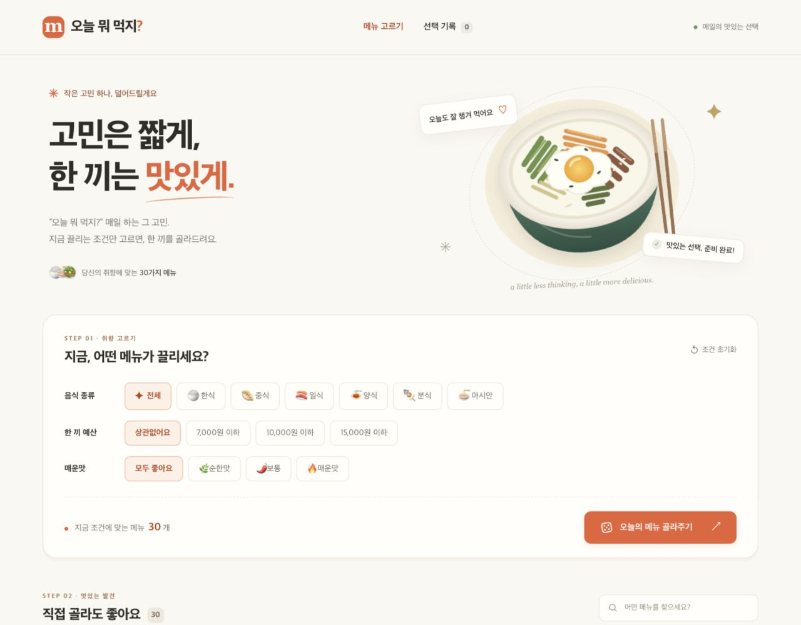
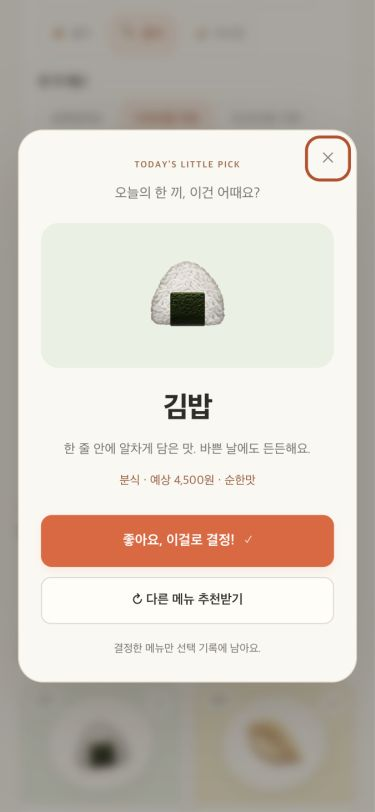
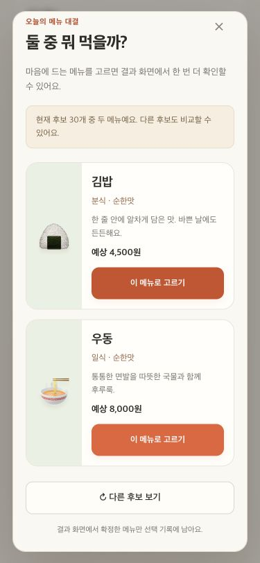
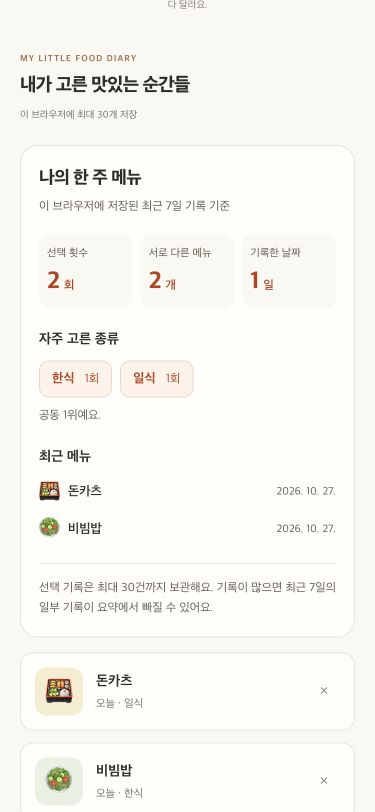

# 오늘 뭐 먹지? 🍽️

**고민은 짧게, 한 끼는 맛있게.**

음식 종류·예산·매운맛으로 후보를 좁히고 오늘 먹을 메뉴를 고르는 웹앱입니다.

> 인공지능프로그래밍 중간고사 · 기존 실습 결과물 없이 시작한 신규 프로젝트

**[웹앱 실행하기](https://baw-appie.github.io/oneul-menu/)** · **[GitHub Public 저장소](https://github.com/Baw-Appie/oneul-menu)** · **[커밋 내역](https://github.com/Baw-Appie/oneul-menu/commits/main/)**



## 1. 제작한 것 소개

### 제작 목적

점심과 저녁마다 반복되는 “뭘 먹지?”라는 고민을 줄이고 싶다는 상황에서 출발했습니다. 원하는 조건으로 메뉴를 추린 뒤 하나를 추천받거나, 목록에서 직접 선택할 수 있습니다.

주 사용자는 한 끼 예산과 음식 취향을 고려해 빠르게 메뉴를 결정하려는 대학생입니다. 기본 추천은 조건 필터와 무작위 선택으로 동작합니다. 추가 개발에서는 GPT-6 Luna(`gpt-6-luna`)가 문장을 해석하는 자연어 검색을 연결했습니다. **AI 검색은 API 키가 설정된 로컬 서버에서 동작하며, GitHub Pages 공개 데모에는 아직 AI 서버가 연결되어 있지 않습니다.**

### 구현 기능

- **메뉴 180개**: 한식·중식·일식·양식·분식·아시안 메뉴와 예시 가격, 매운맛 표시. 이 중 150개는 카카오맵 ‘제주시청’ 주변 음식점 검색에서 자주 보인 메뉴 유형(고기국수·몸국·흑돼지 근고기·보말칼국수 등)
- **복합 조건**: 종류, 최대 예산, 매운맛, 이름·설명·태그 검색을 동시에 적용
- **메뉴 제외·복원**: 원하지 않는 메뉴를 후보에서 빼고 다시 포함
- **무작위 추천**: 화면에 나온 후보에서 선택하고, 여러 후보가 있으면 직전 추천 회피
- **결과 확정**: 추천 창에서 확정해야 기록에 추가. 취소한 추천은 기록하지 않음
- **선택 기록**: 같은 날짜의 같은 메뉴 중복 방지, 최신 30개 보관, 개별 삭제
- **브라우저 저장**: 필터·제외 목록·기록을 새로고침 후 복원
- **사용성**: 모바일 화면, 키보드 조작, 빈 결과 안내, 저장 실패 안내
- **자연어 검색**: “만원 이하로 맵지 않은 국물 요리”처럼 입력하면 현재 조건 안에서 메뉴를 검색. 결과 설명·취소·검색 해제 지원
- **최근 먹은 메뉴 제외**: 끄기·3일·7일 중 선택. 오늘을 포함한 로컬 날짜 기준이며 화면·추천·AI 검색이 같은 후보 사용
- **즐겨찾기**: 카드의 ♡로 추가·해제하고 즐겨찾기만 후보로 보기
- **두 메뉴 비교**: 현재 후보 중 서로 다른 두 메뉴를 나란히 보고 하나 고르기. 결과 창에서 확정해야 기록
- **최근 7일 요약**: 선택 횟수, 서로 다른 메뉴 수, 기록한 날짜 수, 가장 자주 고른 음식 종류(공동 1위 포함)와 최근 메뉴
- **파일 백업**: 조건·제외·즐겨찾기·기록을 JSON 파일로 내보내고, 불러오기 전 현재 저장 내용과 비교 후 대체 또는 취소
- **Docker 실행**: 의존성 설치 없는 Dockerfile과 Compose 설정

가격은 직접 작성한 **시연용 예시 금액**입니다. 실제 가격·재료·매운맛은 식당마다 다릅니다. 식당 검색이나 배달 주문 서비스는 아닙니다.

### 실행 방법

별도 패키지 설치나 빌드 없이 실행합니다. 로컬 실행에는 Node.js 20 이상이 필요합니다.

```bash
node server.mjs
```

터미널에 출력되는 `http://127.0.0.1:4173`을 브라우저에서 엽니다. 종료는 `Ctrl+C`입니다. 포트를 바꾸려면 macOS/Linux에서 `PORT=4174 node server.mjs`로 실행합니다.

**AI 검색 실행:** `.env.example`을 `.env`로 복사하고 `OPENAI_API_KEY`를 설정한 뒤 실행합니다. `.env`는 Git에서 제외됩니다. Node.js 20.6 이상이 필요합니다.

```bash
node --env-file=.env server.mjs
```

[자연어 검색 설정·동작·한계](docs/AI_SEARCH.md)를 참고하세요. 검색 문장과 메뉴 후보만 OpenAI로 전송하고 선택 기록은 전송하지 않습니다. 실제 키를 소스·README·채팅에 넣지 마세요.

JavaScript ES modules를 사용하므로 `index.html`을 더블클릭하는 `file://` 실행 대신 위 HTTP 서버 또는 정적 호스팅을 사용합니다.

**Docker 실행:** `.env.example`을 `.env`로 복사한 뒤 실행하고 `http://localhost:4173`에 접속합니다. 키가 비어 있어도 기본 메뉴 기능은 동작합니다. 포트·접속 주소 설정은 [Docker 배포 안내](docs/DEPLOYMENT.md)를 참고하세요.

```bash
docker compose up -d --build --wait
```

저장 데이터는 **현재 브라우저와 접속 주소**에 속합니다. 로컬 주소와 배포 주소의 기록은 서로 다르며, 브라우저 데이터를 지우면 기록도 사라집니다. 다른 브라우저로 옮기려면 선택 기록 영역의 **파일로 내보내기·파일에서 불러오기**를 사용합니다.

### 기술과 파일 구조

HTML, CSS, JavaScript만 사용합니다. 기본 메뉴 기능은 외부 API·이미지 서버·폰트·런타임 라이브러리에 의존하지 않습니다. 자연어 검색만 로컬 서버의 내장 `fetch`로 OpenAI Responses API를 호출합니다. 소개 그림은 직접 작성한 SVG이며 메뉴 그림은 시스템 이모지입니다.

```text
index.html                         화면과 결과 대화상자
styles.css                         PC·모바일 스타일
src/data.mjs                       메뉴 180개
src/core.mjs                       필터·추천·기록·저장값 검증
src/app.mjs                        화면 갱신과 사용자 이벤트
src/ai-search.mjs                  자연어 검색 상태·취소·결과 연결
src/recent-meals.mjs               최근 먹은 메뉴 제외 기간 계산
src/favorites.mjs, .css            즐겨찾기 토글과 하트 버튼
src/menu-duel.mjs, .css            두 메뉴 비교 대화상자
src/history-summary.mjs, .css      최근 7일 기록 요약
src/backup.mjs, .css               JSON 파일 내보내기·불러오기
server.mjs                         로컬 웹 서버
server/ai-search.mjs               GPT-6 Luna 호출과 응답 검증
server/search-route.mjs            API 경로·입력 크기·요청 제한·접속 주소 검사
assets/                            SVG 그림과 아이콘
tests/                             node:test 자동 테스트
.github/workflows/test.yml         GitHub Actions 테스트 실행
Dockerfile, compose.yaml           컨테이너 이미지와 실행 설정
.dockerignore                      빌드 컨텍스트 허용 목록
docs/PRD.md                        제품 요구사항
docs/TODO.md                       단계별 작업과 실제 변경 내역
docs/VERIFICATION.md               수행한 검증과 한계
docs/AI_SEARCH.md                  자연어 검색 실행과 데이터 처리
docs/DEPLOYMENT.md                 Docker 실행·환경변수·운영 안내
docs/RECENT_MEALS.md 외 3개        기능별 설계·검증 기록
skills/meal-picker-review/SKILL.md   프로젝트 전용 스킬
```

## 2. PRD와 Todo 리스트

전체 문서: [PRD](docs/PRD.md) · [Todo와 변경 내역](docs/TODO.md)

### PRD 요약

| 구분 | 내용 |
| --- | --- |
| 문제 | 메뉴 선택에 반복해서 시간을 쓰고, 예산과 취향에 맞춰 후보를 좁히기 어려움 |
| 대상 | PC·모바일 브라우저로 오늘 먹을 메뉴를 고르는 대학생 |
| 핵심 가치 | 조건 선택 → 후보 확인 → 추천 또는 직접 선택 → 기록 |
| 필수 기능 | 메뉴 탐색, 복합 필터·제외, 추천, 선택 기록, 브라우저 저장 |
| 완성 기준 | 조건에 맞는 결과, 후보 0/1개 처리, 중복 기록 방지, 새로고침 복원, 모바일 사용, 백업 왕복 복원과 손상 파일 거부 |
| 추가 기능 | v2: GPT-6 Luna 자연어 검색(F7–F8) · v3: 최근 메뉴 제외, 즐겨찾기, 두 메뉴 비교, 7일 요약(F9–F12) · Docker 실행 · 파일 백업(F13) |
| 제외 범위 | 로그인, 계정 기반 기기 간 자동 동기화, 지도, 실시간 가격, 주문·결제, 영양·알레르기 판정, 공개 AI 서버 배포 |

### 초기 작업 순서

1. **기획**: PRD, Todo, 스킬 작성 후 첫 커밋
2. **화면**: 30개 메뉴 데이터와 반응형 기본 화면 구현 후 커밋
3. **기능**: 필터, 추천, 확정, 기록·저장 기능 구현 후 커밋
4. **검증**: 경계 상황과 브라우저 흐름 확인, 발견한 문제 수정 후 커밋
5. **제출 준비**: README·스킬·회고 초안 정리, Public 저장소와 실행 주소 확인

작업마다 `단계-순번` 번호와 PRD 근거를 붙였습니다. 처음부터 완료된 프로젝트를 한 번에 커밋하지 않았으며, 최초 계획은 `2318c27`에 보존했습니다.

| 커밋 | 작업 내용 |
| --- | --- |
| [2318c27](https://github.com/Baw-Appie/oneul-menu/commit/2318c27) | PRD, 초기 Todo, 검증 스킬 작성 |
| [5ecb9bf](https://github.com/Baw-Appie/oneul-menu/commit/5ecb9bf) | 반응형 기본 화면과 메뉴 30개 |
| [2cda38c](https://github.com/Baw-Appie/oneul-menu/commit/2cda38c) | 복합 필터, 추천, 선택 기록과 브라우저 저장 |
| [942d673](https://github.com/Baw-Appie/oneul-menu/commit/942d673) | 실제 검증 후 키보드 탐색·빈 결과 복원 개선 |
| [d39d20e](https://github.com/Baw-Appie/oneul-menu/commit/d39d20e) | 과제 README, 스킬 사용 내역, 발표 시연 가이드 |
| [ee534ff](https://github.com/Baw-Appie/oneul-menu/commit/ee534ff) | 공개 데모 링크와 배포 확인 결과 |

### 이후 추가 작업

초기 제출 범위를 마친 뒤 요청에 따라 기능을 추가했습니다. 각 단계도 계획 커밋과 구현 커밋을 나눠 남겼습니다.

| 단계 | 커밋 | 작업 내용 |
| --- | --- | --- |
| 6. 자연어 검색 | [4f7f8c3](https://github.com/Baw-Appie/oneul-menu/commit/4f7f8c3) | GPT-6 Luna 검색과 서버 키 관리 계획 |
| | [8b676fd](https://github.com/Baw-Appie/oneul-menu/commit/8b676fd) | 로컬 서버를 통한 자연어 메뉴 검색 |
| | [d460781](https://github.com/Baw-Appie/oneul-menu/commit/d460781) | 메뉴 포커스 보존, 실제 검색 결과 기록 |
| | [1e1e80c](https://github.com/Baw-Appie/oneul-menu/commit/1e1e80c) | 모바일 검색 화면 캡처 |
| 7. 기록 기반 추천 | [58477ff](https://github.com/Baw-Appie/oneul-menu/commit/58477ff) | 네 가지 개선 기능 계획 |
| | [6b01327](https://github.com/Baw-Appie/oneul-menu/commit/6b01327) | 즐겨찾기와 접근 가능한 하트 버튼 |
| | [995c583](https://github.com/Baw-Appie/oneul-menu/commit/995c583) | 로컬 날짜 기준 최근 메뉴 제외 |
| | [5f75833](https://github.com/Baw-Appie/oneul-menu/commit/5f75833) | 두 메뉴 비교 |
| | [b977b84](https://github.com/Baw-Appie/oneul-menu/commit/b977b84) | 최근 7일 기록 요약 |
| | [1afdbe2](https://github.com/Baw-Appie/oneul-menu/commit/1afdbe2) | 네 기능의 화면·저장·AI 검색 후보 통합 |
| 8. Docker | [d54cd8b](https://github.com/Baw-Appie/oneul-menu/commit/d54cd8b) | Dockerfile·Compose와 배포 주소 설정 |
| 9. 파일 백업 | [68d911f](https://github.com/Baw-Appie/oneul-menu/commit/68d911f) | 기록 파일 내보내기·불러오기 |

## 3. Todo 리스트의 변경 내역

최초 계획과 비교한 **실제 변경 사항**입니다. 처음부터 계획했던 기능을 나중에 추가한 것처럼 꾸미지 않았습니다.

| 관련 Todo | 처음 계획 | 실제 변경 | 변경 이유와 확인 결과 |
| --- | --- | --- | --- |
| 3-5, 4-3 | 삭제 후 다음 요소에 포커스 이동 | 남은 삭제 버튼의 기본 Tab 순서 유지 | 실제 브라우저에서 삭제 후 `tabindex=-1`이 남는 문제 발견. 수정 후 속성이 없는 기본 버튼으로 유지됨을 확인 |
| 3-1, 4-3 | 별도 제외 목록에서 메뉴 복원 | 빈 결과 안내에 **제외한 메뉴 다시 포함** 버튼 추가 | 검색 결과 하나를 제외했을 때 복원 경로를 더 쉽게 찾도록 개선. 클릭 후 후보 1개 복구 확인 |
| 3-5, 4-3 | 빈 결과에서 조건 초기화 | 초기화 후 추천 또는 제외 관리로 포커스 이동 | 초기화 버튼이 사라져도 키보드 사용자가 다음 동작을 이어갈 수 있도록 개선 |
| 2-4, 4-4 | 미리보기 서버의 src·assets 경로 허용 | 제공할 파일명·확장자를 앱 자원으로 제한 | 코드 검토 후 로컬 서버가 제공하는 파일 범위를 명시적으로 좁힘 |
| 6-1–6-6 | AI API 없이 키워드 검색만 제공 | GPT-6 Luna 자연어 검색 추가, 서버에서 키 관리 | 사용자가 모델과 로컬 실행 범위를 확인. 실제 문장 검색에서 쌀국수·돼지국밥·우동, 한식 조건에서는 돼지국밥 확인 |
| 7-1–7-6 | 조건 검색·추천과 선택 기록 제공 | 최근 메뉴 제외·즐겨찾기·두 메뉴 비교·기록 요약 추가 | 사용자가 제안된 네 기능을 모두 구현하도록 요청. 672개 후보 조합과 실제 브라우저 통합 흐름 확인 |
| 7-5, 7-6 | 결과창을 닫을 때 브라우저 기본 포커스 복원 | 목록 갱신 후 기존 카드·비교 버튼·추천 버튼 중 유효한 대상으로 포커스 복원 | 실제 브라우저에서 확정 후 포커스가 문서로 빠지는 문제를 발견하고 비교→확정 후 복원을 재검증 |
| 8-1–8-4 | 로컬 Node 서버와 정적 호스팅으로 실행 | Dockerfile·Compose와 배포 주소 설정 추가 | 사용자가 Docker 배포 파일을 요청. 기존 localhost 바인딩·API 주소 검사를 배포 환경에 맞게 구성 |
| 9-1–9-4 | 저장 위치는 브라우저뿐이며 기록을 옮길 방법 없음 | 조건·기록을 JSON 파일로 내보내고 불러오는 수동 백업 추가 | 사용자가 파일 내보내기·가져오기를 선택. 알 수 없는 버전의 파일이 기존 기록을 지우지 않도록 버전을 먼저 확인 |
| 2-1, 11-1–11-3 | 직접 작성한 메뉴 30개 | 제주시청 주변 지도 검색을 참고한 메뉴 150개 추가(총 180개) | 사용자가 메뉴 수가 적다며 추가를 요청. 기존 6개 음식 종류를 유지하고 ID·가격·매운맛·AI 요청 크기를 검증 |

기획에서 정한 로그인·지도·주문 등의 제외 범위는 유지했습니다. 파일 백업은 사용자가 직접 파일을 옮기는 방식이며 자동 동기화는 여전히 제외합니다.

### 검증 결과

- **로직 12개 그룹 통과**: 112개 필터 조합, 예산 경계, 후보 0/1/다수, 재추천, 중복 방지, 로컬 날짜, 최신 30개 제한, 저장값 검증 등
- **저장 실패 모의 시나리오 2개 통과**: 손상된 JSON과 저장소 차단에서도 화면·필터 동작 유지
- **실제 브라우저 확인**: 추천·취소·재추천·확정·중복 방지·새로고침·검색·제외 복원·기록 삭제
- **반응형 확인**: 375px와 1280px에서 가로 넘침 없음. 모바일 추천 창 및 Enter/Escape 조작 확인
- **오류 로그**: 확인 시 브라우저 error/warn 로그 없음
- **자연어 검색 추가 검증**: 16개 모의 검증 그룹과 실제 GPT-6 Luna 호출 4회 확인. 후보 밖 ID 거부, 오류·취소·오래된 응답 무시, 10원 이하 검색의 빈 결과, 모바일 입력 검증
- **v3 기능 통합 검증**: 기능별 로직 검증(최근 제외 15개, 즐겨찾기 9개, 비교 15개, 요약 19개 그룹)과 종류 × 예산 × 매운맛 × 최근 제외 × 즐겨찾기 **672개 후보 조합** 대조. 실제 브라우저에서 즐겨찾기→비교→확정→최근 제외→새로고침 흐름과 모의 AI 서버 연동 확인
- **Docker 검증**: 이미지 빌드, Compose 기동 후 `healthy`, 접속 주소 검사 44건, 이미지에 `.env`·Git 이력·문서가 포함되지 않음 확인. 실제 도메인·TLS 배포는 하지 않음
- **파일 백업 검증**: 순수 함수 14개 그룹(형식, 왕복 복원, 손상 파일·다른 앱·알 수 없는 버전 거부, 30건 한계) 통과. **실제 브라우저의 다운로드·파일 선택·대화상자 조작은 아직 확인하지 못함**

[검증 환경·세부 결과·미검증 범위](docs/VERIFICATION.md)에 실제 수행 내용을 구분해서 기록했습니다. 임시 검증 코드는 저장소에 남기지 않았습니다.

<details>
<summary>모바일 추천 화면 보기</summary>



</details>

<details>
<summary>모바일 두 메뉴 비교·기록 요약 화면 보기</summary>




</details>

## 4. 스킬

### 직접 만든 스킬: meal-picker-review

**만든 이유:** 화면이 보기 좋아도 필터와 추천 후보가 다르거나, 기록이 중복되거나, 날짜가 잘못 구분되면 앱의 목적을 달성하기 어렵습니다. 이 프로젝트에서 반복 확인해야 하는 판단 기준을 재사용할 수 있는 절차로 정리했습니다.

**적용 방법:** 루트 `AGENTS.md`에서 메뉴 데이터·필터·추천·기록을 수정할 때 이 스킬을 읽도록 연결했습니다. 첫 기능 구현 전에 실제로 읽고 적용했습니다.

| 스킬 규칙 | 실제 사용 사례 |
| --- | --- |
| 필터는 AND, 예산 경계 포함 | 112개 조합과 10,000원 경계 조건 검증 |
| 화면 후보와 추천 후보 일치 | `filterMenus()`의 결과를 카드와 추천에서 공통으로 사용 |
| 후보 0/1/다수 구분 | 빈 결과 안내, 후보 하나일 때 재추천 비활성화, 다수일 때 직전 추천 제외 |
| 확정한 메뉴만 기록 | Escape 취소 후 기록 0개, 같은 메뉴 두 번 확정 후 기록 1개, 비교창에서 고르기만 하면 기록 0개 확인 |
| 로컬 날짜 기준 | `localDateKey()` 사용, 서울 자정 부근 날짜 검증. 최근 메뉴 제외는 6개 시간대와 자정·월말·윤년·DST 경계 검증 |
| 저장값을 신뢰하지 않음 | 메뉴 ID·날짜·필터 값 정규화, 손상된 JSON·저장 차단 처리. 불러온 백업 파일에도 같은 정규화 적용, 알 수 없는 버전은 거부 |
| 키보드 흐름 확인 | 기록 삭제 후 Tab 탐색 문제를 발견하고 수정 |
| 사실에 근거한 기록 | 실제 변경·검증만 Todo에 기록하고 회고는 사용자 검토용 초안으로 구분 |
| 자연어 검색 확장 규칙 | 모델 결과를 기존 후보의 부분집합으로 검증하고, 입력 변경 시 이전 응답 무효화. 실제 호출과 모의 검증을 구분 |

#### SKILL.md 전문

원본: [skills/meal-picker-review/SKILL.md](skills/meal-picker-review/SKILL.md)

```markdown
---
name: meal-picker-review
description: 오늘 뭐 먹지 웹앱의 메뉴 데이터, 조건 필터, 무작위 추천, 선택 기록을 구현하거나 수정할 때 제품 규칙과 경계 상황을 검증한다.
---

# 메뉴 추천 검증

## 제품 규칙

- 메뉴 ID는 중복되지 않아야 한다. 가격은 원 단위의 양의 정수이며 시연용 예시다. 매운맛은 0(순한맛), 1(보통), 2(매운맛) 중 하나다.
- 검색어와 음식 종류, 최대 예산, 매운맛, 제외 ID는 AND로 결합한다. 예산과 같은 가격의 메뉴도 포함한다.
- 추천 후보는 화면에 표시한 필터 결과와 같아야 한다. 후보 0개는 안내, 1개는 그 메뉴, 여러 개면 바로 직전 추천을 뺀 후보에서 균등 선택한다.
- 추천 대화상자를 열기만 해서는 기록하지 않는다. 사용자가 확정한 메뉴만 기록한다. 같은 로컬 날짜와 메뉴 ID 조합은 한 번만 남긴다.
- 날짜는 사용자의 로컬 달력 날짜로 판단한다. UTC 날짜 문자열을 잘라 하루를 구분하지 않는다.
- 저장 데이터는 신뢰하지 않는다. 알려진 메뉴 ID, 필터 선택값, 날짜와 목록 크기를 검증하고 잘못된 항목을 버린다. 저장을 사용할 수 없어도 메모리에서 앱을 계속 쓸 수 있어야 한다.
- 자연어 검색 결과는 서버에 보낸 후보의 부분집합이어야 한다. 모델이 반환한 ID와 설명도 검증한다. 카드와 랜덤 추천은 같은 AI 결과 집합을 사용한다.
- 검색어·조건이 바뀌거나 검색을 취소하면 진행 중 응답을 무시한다. 실패한 검색은 기존 조건 검색을 망가뜨리지 않는다. 실제 모델 호출과 모의 검증을 구분한다.
- API 키는 서버 환경 변수에서만 사용한다. 검색 문장과 후보만 전송하고 기록은 전송하지 않는다. 실제 재료 정보가 없는 메뉴에 알레르기 안전성을 보장하지 않는다.

## 확인 절차

1. 변경한 PRD 항목과 Todo 번호를 확인한다.
2. 데이터 변경이면 ID·가격·매운맛을 검사한다. 추천 변경이면 조건을 여러 개 겹친 경우와 후보 0/1/다수를 확인한다.
3. 추천 → 다시 추천 → 확정 → 새로고침 → 기록 삭제 흐름을 검증한다. 취소한 추천이 기록되지 않는지도 확인한다.
4. 키보드로 대화상자 열기·닫기·확정이 가능한지, 모바일에서 조건과 결과가 잘리지 않는지 확인한다.
5. 실제 수행한 검증과 미수행 항목을 구분하여 기록한다. 개선으로 계획이 바뀌면 `docs/TODO.md`에 변경 전·후와 근거를 남긴다.

## 예시

한식 / 10,000원 이하 / 순한맛 조건에서는 10,000원 메뉴가 포함되고 11,000원 메뉴는 제외된다. 모든 후보를 제외했다면 임의의 다른 음식을 추천하지 않고 조건 초기화 또는 제외 해제를 안내한다.

## 문서화

발견하지 않은 버그, 실행하지 않은 테스트, 사용자가 말하지 않은 소감을 사실처럼 쓰지 않는다. 자동 검증용 임시 파일은 저장소에 남기지 않고 결과만 문서화한다.
```

### 보조로 사용한 기존 스킬

직접 만든 스킬과 구분해 기록합니다. 당시 읽은 `SKILL.md` 내용을 아래 파일에 보존했습니다. 복사본은 사용 내역을 설명하기 위한 참고 자료이며 프로젝트에 새 작업 권한을 부여하지 않습니다.

| 스킬 | 고른 이유 | 이번 작업에서의 적용 | SKILL.md 내용 |
| --- | --- | --- | --- |
| `pdf` | 첨부된 수업 PDF에서 과제 관련 맥락 확인 | 자료의 텍스트 검토. 예시 지시와 사용자 요청을 구분. Poppler가 없어 시스템 PDFKit으로 추출 | [전문](docs/reference-skills/pdf.SKILL.md) |
| `sites` | 웹앱 구현·미리보기 절차 참고 | 정적 웹앱, 반응형 화면, 로컬 미리보기와 확인. Sites 배포 도구는 연결되지 않아 사용하지 않음 | [전문](docs/reference-skills/sites.SKILL.md) |
| `skill-creator` | 전용 검증 절차를 스킬로 구조화 | name·description·제품 규칙·절차·예시 작성. 자동 형식 검증기는 PyYAML 부재로 실행되지 않아 수동 검토 | [전문](docs/reference-skills/skill-creator.SKILL.md) |
| `openai-docs` | 요청한 모델의 공식 이름과 API 방식 확인 | GPT-6 Luna로 사용자 확인 후 Responses API·Structured Outputs·서버 인증 방식을 적용 | [전문](docs/reference-skills/openai-docs.SKILL.md) |

## 5. 느낀점과 결론

### 개발 결과에서 확인한 점

- 기능을 작은 Todo로 나누어 진행하면 화면·핵심 기능·개선 시점의 차이를 커밋으로 확인할 수 있습니다.
- 정상적인 추천만 확인해서는 충분하지 않았습니다. 후보가 없거나 하나뿐인 상황, 저장소를 사용할 수 없는 상황도 별도로 다뤄야 했습니다.
- 화면에서 클릭이 되는 것과 키보드로 계속 사용할 수 있는 것은 다릅니다. 실제 브라우저 확인에서 기록 삭제 후 Tab 탐색 문제를 발견했습니다.
- 스킬은 단순히 파일을 만들어 첨부하는 것보다 실제 구현 기준과 확인 절차에 적용할 때 의미가 있습니다.

### 느낀점

처음에는 스킬을 자주 쓰는 지시를 줄여 부르는 단축어 정도로 생각했다. 매번 AI에게 같은 요구사항을 설명하지 않으려고 만든 것이었다. 그런데 메뉴 추천 규칙을 SKILL.md로 정리해 두니, 스킬은 명령을 줄여주는 도구라기보다 프로젝트가 지켜야 할 기준에 가까웠다. 

그 차이를 실제로 느낀 건 기능을 추가할 때였다. 자연어 검색, 즐겨찾기, 최근 메뉴 제외, 두 메뉴 비교를 붙일 때마다 "확정한 메뉴만 기록한다", "화면에 보이는 후보와 추천 후보는 같아야 한다" 같은 규칙을 다시 설명할 필요가 없었다. 규칙이 SKILL.md에 남아 있으니 AI도 새 기능을 같은 기준으로 확인했고, 나는 결과가 그 기준에 맞는지만 보면 됐다.

바이브 코딩이라고 하면 말로 시키면 알아서 다 만들어 주는 모습을 떠올렸다. 막상 해 보니 내가 할 일이 사라진다기보다 바뀌는 쪽에 가까웠다. 코드를 한 줄씩 쓰는 대신 무엇을 만들지 정하고, 어디까지 만들지 선을 긋고, 결과가 맞는지 확인하는 일이 남았다. PRD에서 로그인·지도·주문을 처음부터 범위 밖으로 빼 둔 덕분에 기능을 계속 추가하면서도 앱이 원래 목적에서 벗어나지 않았다.

검증하면서는 "완료했다"는 말과 실제로 동작하는 것이 다르다는 걸 배웠다. 화면에서는 멀쩡해 보였는데, 실제 브라우저에서 키보드로 써 보니 기록을 삭제한 뒤 Tab 이동이 꼬이는 문제가 있었다. 그래서 검증 기록에도 실제로 해 본 것과 해 보지 못한 것을 나눠 적었다. 파일 백업은 작업 환경 제한 때문에 실제 브라우저에서 확인하지 못했는데, 이를 숨기지 않고 그대로 적어 두는 편이 더 믿을 수 있는 기록이라고 생각한다.

처음 계획에 없던 AI 검색을 넣으면서 기능 하나를 붙이는 일이 코드 몇 줄로 끝나지 않는다는 것도 알게 됐다. API 키를 어디에 둘지, 공개 데모에서는 어떻게 할지, 모델이 후보에 없는 메뉴를 돌려주면 어떻게 막을지 같은 고민이 함께 따라왔다. Docker 설정도 결국 이 서버를 어디서 어떻게 돌릴지 고민하다가 만들게 됐다.

v3에서는 기능 네 개를 채팅 네 개에 나눠 동시에 맡겼다. 속도는 빨랐지만 각자 만든 결과를 하나로 합치는 통합 작업은 따로 해야 했다. AI 여러 개를 동시에 쓰는 일도 사람이 팀으로 일할 때처럼 역할을 나누고 합치는 기준을 정해야 했다. 다음 프로젝트에서도 기능보다 지켜야 할 규칙을 먼저 정리하고 시작하려고 한다.

### 결론과 향후 개선

이번 버전은 **조건 선택 → 메뉴 결정 → 기록**의 핵심 흐름을 브라우저에서 실행할 수 있는 형태로 완성했습니다. 서버·계정 없이 사용할 수 있는 대신 자동 기기 간 동기화와 실제 식당 정보는 제공하지 않습니다. 기록을 옮길 때는 파일 백업을 사용합니다.

추가된 자연어 검색은 API 서버와 OpenAI API 키가 필요합니다. 기본 기능은 기존처럼 정적 호스팅에서 사용할 수 있으며, 공개 주소의 AI 기능까지 사용하려면 Docker 설정으로 별도 서버를 배포하고 인증·사용량 제한을 추가해야 합니다.

## 발표 시연 순서

1. 제작 목적과 최초 PRD·Todo 소개
2. 한식 / 10,000원 이하 / 순한맛을 선택하고 후보 3개 확인
3. 추천 → 다른 메뉴 추천 → 확정 → 선택 기록 확인
4. 새로고침 후 조건과 기록이 유지되는 모습 확인
5. 검색으로 후보 1개만 남기고 제외 → 빈 결과 → 다시 포함 시연
6. 메뉴 두 개를 즐겨찾기 → 즐겨찾기만 보기 → 두 메뉴 비교 → 확정
7. 최근 3일 제외로 방금 고른 메뉴가 빠지는 모습과 최근 7일 요약 확인
8. 파일로 내보내기 → 파일에서 불러오기 → 비교 대화상자 확인
9. Todo 변경 내역, 실제 스킬 적용 사례, 커밋 내역, 한계와 느낀점 설명
